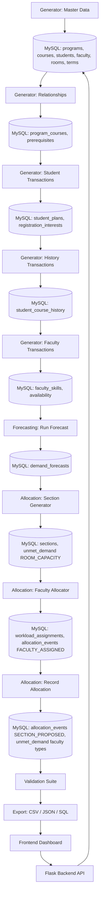
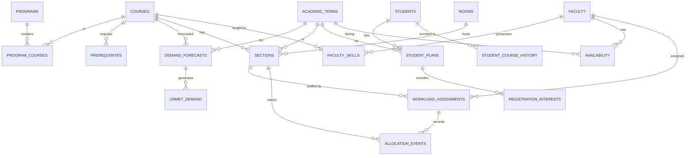

# System Design Documentation

Technical architecture and design of the YottaFlex Course Demand & Allocation System.

---

## Architecture Overview

The system follows a modular, pipeline-oriented architecture built on **Flask + MySQL + Python**. Each module is a standalone script that reads from and writes to the central MySQL database. The frontend is a server-rendered dashboard using Jinja2 templates and Chart.js.

```
┌─────────────┐     ┌──────────────┐     ┌───────────────┐     ┌────────────┐
│  Generator  │────▶│   Forecasting│────▶│   Allocation  │────▶│  Backend   │
│  (Synthetic │     │  (Demand     │     │  (Sections,   │     │  (Flask +  │
│   Data)     │     │   Predict)   │     │   Faculty)    │     │   API)     │
└─────────────┘     └──────────────┘     └───────────────┘     └─────┬──────┘
                                                                      │
                                                                      ▼
┌─────────────┐     ┌──────────────┐     ┌───────────────┐     ┌────────────┐
│   Export    │◀───│  Validation  │◀───│   Database    │◀────│  Frontend  │
│  (CSV/JSON/ │     │  (Integrity  │     │   (MySQL)     │     │  (Dashboard)│
│   SQL)      │     │   Checks)    │     │               │     │            │
└─────────────┘     └──────────────┘     └───────────────┘     └────────────┘
```

---

## Component Responsibilities

| Component | Location | Responsibility |
|-----------|----------|----------------|
| **Generator** | `generator/` | Creates all synthetic master data (programs, courses, students, faculty, rooms, terms) and transactional data (student plans, interests, history, faculty skills, availability). |
| **Forecasting** | `forecasting/` | Computes course demand forecasts using historical enrollments and registration interests. Produces confidence scores and demand categories. |
| **Allocation** | `allocation/` | Generates course sections (room + time), assigns qualified faculty, records allocation events, and calculates unmet demand. |
| **Backend** | `backend/` | Flask application serving the dashboard and API endpoints. Manages DB connections via connection pooling (single connection per request). |
| **Frontend** | `frontend/` | Static assets (CSS) and Jinja2 templates. Dashboard renders stats cards, Chart.js bar chart, and forecast table. |
| **Database** | MySQL (`course_demand_db`) | Central persistence layer. 19 tables covering master data, transactions, forecasts, allocations, and audit events. |
| **Tests** | `tests/` | Validation scripts for data integrity, business rules, export verification, and synthetic anomaly detection. |
| **Export** | `generator/export_data.py` | Dumps entire database to CSV (per table), JSON (structured), and SQL (schema + data). |

---

## End-to-End Data Flow



### Execution Order Dependencies

| Phase | Scripts | Must Follow |
|-------|---------|-------------|
| 1. Master Data | `generator.main` | — |
| 2. Relationships | `generator.relationships` | Phase 1 |
| 3. Student Txns | `generator.student_transactions` | Phases 1–2 |
| 4. History Txns | `generator.history_transactions` | Phase 3 |
| 5. Faculty Txns | `generator.faculty_transactions` | Phases 1–2 |
| 6. Forecasting | `forecasting.run_forecast` | Phases 1, 3, 4 |
| 7. Section Gen | `allocation.section_generator` | Phases 1, 2, 6 |
| 8. Faculty Alloc | `allocation.faculty_allocator` | Phases 1, 5, 7 |
| 9. Record Alloc | `allocation.record_allocation` | Phases 6, 7, 8 |
| 10. Validation | `tests.validate_*` | All above |
| 11. Export | `generator.export_data` | All above |
| 12. Dashboard | `backend.app` | All above |

---

## Database Design

### Entity-Relationship Overview



### Key Tables and Purposes

| Table | Purpose | Key Relationships |
|-------|---------|-------------------|
| `programs` | Academic programs | 1:N `program_courses` |
| `courses` | Course catalog | N:M `program_courses`, 1:N `prerequisites` (self), 1:N `demand_forecasts`, 1:N `sections` |
| `academic_terms` | Term calendar | 1:N `demand_forecasts`, `sections`, `student_plans`, `availability` |
| `students` | Student roster | 1:N `student_plans`, `student_course_history` |
| `student_plans` | Term enrollment plan | N:1 `students`, `programs`, `terms`; 1:N `registration_interests` |
| `registration_interests` | Course wishlists | N:1 `student_plans`, `courses` |
| `student_course_history` | Actual enrollments | N:1 `students`, `courses`, `terms` |
| `faculty` | Teaching staff | 1:N `faculty_skills`, `availability`, `workload_assignments` |
| `faculty_skills` | Qualifications | N:1 `faculty`, `courses` |
| `availability` | Time windows | N:1 `faculty` |
| `rooms` | Physical spaces | 1:N `sections` |
| `demand_forecasts` | Predicted demand | N:1 `courses`, `terms`; 1:N `unmet_demand` |
| `sections` | Generated classes | N:1 `courses`, `terms`, `rooms`; 1:N `workload_assignments`, `allocation_events` |
| `workload_assignments` | Faculty assignments | N:1 `sections`, `faculty`; 1:N `allocation_events` |
| `unmet_demand` | Unsatisfied demand | N:1 `demand_forecasts`, `courses`, `terms` |
| `allocation_events` | Audit trail | N:1 `sections`, `workload_assignments` |
| `program_courses` | Curriculum map | N:1 `programs`, `courses` |
| `prerequisites` | Course dependencies | N:1 `courses` (self, two roles) |

### Important Constraints
- `sections.capacity` ≤ `rooms.capacity` (validated, not FK).
- `workload_assignments.assigned_hours` = 3.0 per section.
- `availability.availability_type` ∈ {'AVAILABLE', 'LEAVE'}.
- `faculty_skills.proficiency_level` ∈ {'INTERMEDIATE', 'ADVANCED', 'EXPERT'}.
- `sections.status` = 'PROPOSED'; `workload_assignments.status` ∈ {'PROPOSED', 'APPROVED'}.

---

## Backend Design

### Flask Application (`backend/app.py`)

| Route | Method | Description |
|-------|--------|-------------|
| `/` | GET | Renders `dashboard.html` with stats and top-10 forecast chart data. |
| `/api/summary` | GET | Returns JSON: `{forecasts, sections, assignments, unmet_demand}` for TERM-2027-EVEN. |

### Database Connection (`backend/database.py`)
- `get_connection()`: Creates new `mysql.connector` connection per request using `DB_CONFIG` from `backend/config.py`.
- `test_connection()`: Diagnostic utility.
- **No connection pooling**; each request opens/closes its own connection. Suitable for demo scale.

### Configuration (`backend/config.py`)
- Loads `.env` via `python-dotenv`.
- `DB_CONFIG` dict with host, port, user, password, database, `autocommit=False`.

### Error Handling
- Routes use `try/finally` to ensure cursor/connection closure.
- Database errors propagate to Flask's default error handler (debug mode shows traceback).

---

## Frontend Design

### Template Structure
- `frontend/templates/dashboard.html`: Single-page dashboard.
- Uses **Jinja2** for server-side rendering of stats and forecast table.
- Embeds **Chart.js** bar chart via inline `<script>` using template-filtered JSON.

### Static Assets
- `frontend/static/css/style.css`: Custom styling (sidebar, cards, tables, responsive grid).
- **Bootstrap 5.3.3** via CDN for layout components.
- **Chart.js** via CDN for visualization.

### Dashboard Sections
1. **Top Bar**: Title + term label ("Academic Term: 2027 EVEN").
2. **Stats Grid** (4 cards):
   - Total Forecasts (100)
   - Sections Generated (71)
   - Faculty Assignments (55)
   - Unmet Demand (0–N, warning style)
3. **Chart Card**: Bar chart "Course Demand Analysis" – top 10 courses by predicted enrollment.
4. **Table Card**: "Top Course Demand Forecasts" – Course ID, Name, Predicted Enrollment, Confidence Score.
5. **Footer**: System name.

### Responsive Breakpoints
- ≥1000px: 4-column stats grid, fixed sidebar.
- 650–1000px: 2-column stats grid.
- <650px: Single column, sidebar becomes horizontal header.

---

## Data Export Design

Implemented in `generator/export_data.py`.

### Export Formats

| Format | Function | Output | Details |
|--------|----------|--------|---------|
| **CSV** | `export_csv()` | `data/exports/csv/<table>.csv` | One file per table (18 files). Header row = column names. Dates → ISO format. Decimals → float. |
| **JSON** | `export_json()` | `data/exports/project_data.json` | Single object: `{database, tables: {table: {columns, records}}}`. All values JSON-serializable via `convert_value()`. |
| **SQL** | `export_sql()` | `data/exports/project_data.sql` | `SET NAMES utf8mb4; SET FOREIGN_KEY_CHECKS=0;` + `CREATE TABLE IF NOT EXISTS` + batched `INSERT` (500 rows/batch) + `SET FOREIGN_KEY_CHECKS=1;`. |

### Export Process
1. Connect with `dictionary=True` cursor.
2. `SHOW TABLES` → sorted table list.
3. For each table: `SELECT *`, capture column names and all rows.
4. Write CSV, accumulate in memory for JSON/SQL.
5. Write JSON and SQL files.

### Verification (`tests/validate_exports.py`)
- JSON parseable.
- SQL file exists and non-empty.
- For each table: CSV row count (minus header) == JSON record count.

---

## Technical Constraints

| Area | Constraint | Implication |
|------|------------|-------------|
| **Term Hardcoding** | `TERM-2027-EVEN`, `FORECAST-2027-EVEN-001` in multiple scripts | Not multi-tenant; single-term demo only. |
| **Time Slots** | 3 fixed slots/day, weekdays only | No evening/weekend/variable-length classes. |
| **Faculty Assignment** | Greedy first-fit, 3 hrs/section | No global optimization; may leave sections unassigned. |
| **Room Allocation** | Largest-room-first, sequential slots | May fragment capacity; no backtracking. |
| **Prerequisite Enforcement** | Start after latest prerequisite end | No support for concurrent prerequisites or co-requisites. |
| **Workload** | Per-term, resets each term | No annualized workload tracking. |
| **Connection Management** | New connection per request | Not scalable for high concurrency; fine for demo. |
| **No Migrations** | Schema created via `IF NOT EXISTS` in INSERT scripts | No versioned schema management. |
| **Single Forecast Run** | Aborts if `FORECAST-2027-EVEN-001` exists | Must delete or rename to re-run. |
| **No Auth** | Dashboard open on localhost | Not production-ready. |

---

## Deployment Notes (Development Only)

- **OS**: Windows (PowerShell commands documented).
- **Python**: 3.11+ recommended.
- **MySQL**: Local instance, default port.
- **Port**: Flask defaults to 5000.
- **Virtual Environment**: `venv/` in project root (excluded from version control).
- **Environment Variables**: `.env` (not committed).

---