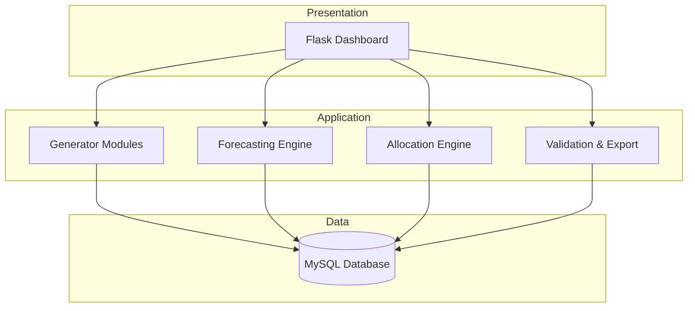
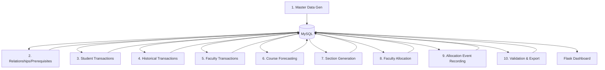
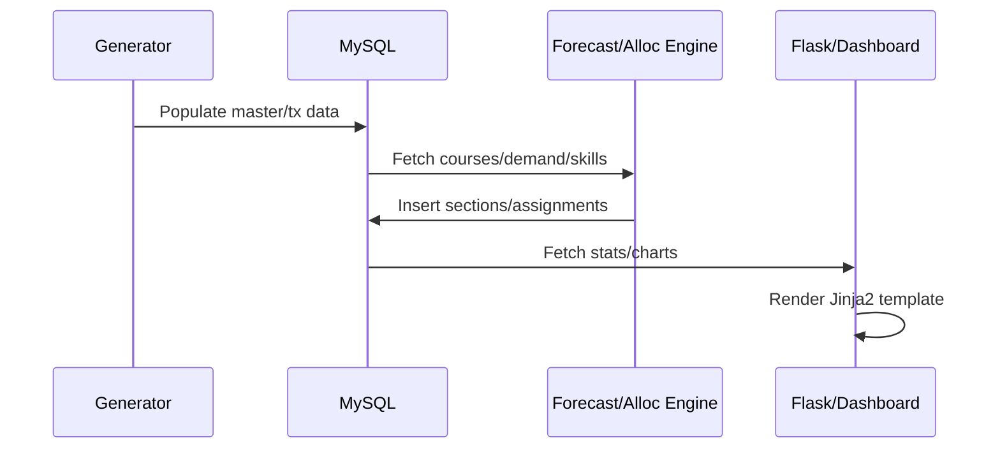

# Technical Documentation: YottaFlex System

This document provides a technical deep dive into the YottaFlex Course Demand & Allocation System, detailing the architecture, workflow, integration, and testing strategies.

---

## 1. Three-Tier Architecture

The system follows a decoupled architecture where independent Python modules orchestrate data flow through a centralized MySQL database, presented via a Flask-based web interface.

### Presentation Layer
- **Interface:** Flask Jinja2 templates (`frontend/templates/dashboard.html`).
- **Styling:** Bootstrap 5 and custom CSS (`frontend/static/css/style.css`).
- **Logic:** In-template data binding and client-side visualization using **Chart.js**.
- **Dashboard:** Provides visibility into aggregated stats, course demand forecasts, and assignment summaries.

### Application Layer
- **Orchestration:** Independent Python scripts orchestrate system processes.
- **Modules:**
    - `generator/`: Data synthesis engine (master data, relationships, student transactions, history transactions, faculty transactions, anomalies).
    - `forecasting/`: Demand calculation and confidence analysis.
    - `allocation/`: Section generation, room mapping, and faculty assignment.
    - `backend/`: Flask web server providing the API and view routes.
    - `tests/`: Validation and testing suite.
- **Communication:** Modules operate sequentially, reading from/writing to MySQL; they do not communicate directly.

### Data Layer
- **Storage:** MySQL 8.0 server (`course_demand_db`).
- **Connectivity:** `mysql-connector-python` with standard synchronous connections.
- **Persistence:** 18 normalized tables managing curriculum, resources, enrollments, and allocations.
- **Exports:** Native capability to dump full datasets to CSV, JSON, and SQL formats via `generator/export_data.py`.

---

## 2. System Workflow

The project operates as a batch-processing pipeline executed in the following order:

| Stage | Script | Input | Output (DB Tables) |
|-------|--------|-------|--------------------|
| 1. Master Data | `generator/main.py` | Random seed | `programs`, `courses`, `students`, `faculty`, `rooms`, `terms` |
| 2. Relationships | `generator/relationships.py` | Programs, Courses | `program_courses`, `prerequisites` |
| 3. Student Transactions | `generator/student_transactions.py` | Students, Programs, Terms | `student_plans`, `registration_interests` |
| 4. History Transactions | `generator/history_transactions.py` | Plans, Interests | `student_course_history` |
| 5. Faculty Transactions | `generator/faculty_transactions.py` | Faculty, Courses, Terms | `faculty_skills`, `availability` |
| 6. Forecast | `forecasting/run_forecast.py` | Hist/Interest data | `demand_forecasts` |
| 7. Sectioning | `allocation/section_generator.py` | Forecasts, Rooms | `sections`, `unmet_demand` (capacity) |
| 8. Allocation | `allocation/faculty_allocator.py` | Sections/Skills/Avail | `workload_assignments`, `allocation_events` |
| 9. Event Recording | `allocation/record_allocation.py` | Sections, Assignments | `allocation_events`, `unmet_demand` (faculty) |
| 10. Validation | `tests/validate_*.py` | All tables | PASS/FAIL reports |

---

## 3. Data Flow

Data flows primarily from the generation phase through the analytical pipeline into the presentation layer.

- **Forecasting:** Reads `student_course_history` + `registration_interests` → writes `demand_forecasts`.
- **Allocation:** Reads `demand_forecasts`, `rooms`, `faculty`, `prerequisites` → writes `sections` + `workload_assignments`.
- **Event Recording:** Reads `sections`, `workload_assignments` → writes `allocation_events`, additional `unmet_demand` records.
- **Dashboard:** Reads from all tables to aggregate summary statistics.

---

## 4. Testing & Validation Strategy

The project utilizes a **script-based validation approach** focused on data integrity, business rules, and constraint verification. **There are no unit tests** (no `unittest`/`pytest` framework usage) and no automated test runner — each validation script must be invoked manually.

| Test File | Type | Purpose | Main Checks |
|-----------|------|---------|-------------|
| `tests/validate_project.py` | Script-based validation | End-to-end pipeline integrity | Row counts, unmet demand, room/skill constraints, FK integrity, duplicates |
| `tests/validate_allocation.py` | Script-based validation | Allocation logic integrity | Workload, scheduling, event history, unmet demand parity |
| `tests/validate_exports.py` | Script-based validation | Export integrity | CSV/JSON/SQL file presence, row parity |
| `tests/check_prerequisite_schedule.py` | Business rule check | Prerequisite ordering | Schedule date violations |
| `tests/check_room_constraints.py` | Business rule check | Room capacity & conflicts | Capacity violations, scheduling conflicts |
| `tests/check_allocation_fks.py` | Integrity check | Foreign key integrity | FK consistency across allocation tables |

---

## 5. Integration Testing — Actual Scope

**Important:** Integration is **not** independently tested at the component-interaction level. What the validation scripts verify is **database state consistency after pipeline execution**, not that each component interaction has been independently tested.

- **Pipeline Integration:** `validate_project.py` confirms data flows correctly from the generator into the forecast and allocation engines **by checking final row counts and constraints** — it does not test intermediate handoffs in isolation.
- **Database Consistency:** `check_allocation_fks` verifies foreign key integrity between sections, assignments, and faculty **in the final database state**.
- **Export Integration:** `validate_exports` ensures that raw database states can be correctly serialized and reconstructed.
- **No Component-Level Integration Tests:** There are no tests that exercise, for example, the `forecasting` module's output being directly consumed by `allocation/section_generator.py` in a controlled test environment. The only integration evidence is the successful end-to-end pipeline run.

---

## 6. Data Validation & Constraint Testing

Validation scripts enforce the following logic:

- **Consistency:** Ensuring `assigned_hours` are linked to valid sections and faculty.
- **Capacity:** Validating `sections.capacity` ≤ `rooms.capacity` across all generated sections.
- **Dependencies:** Ensuring prerequisites are scheduled before their dependent courses.
- **Events:** Maintaining a complete audit trail in `allocation_events` for every `section` and `workload_assignment`.
- **Workload:** No faculty exceeds `max_workload_hours`.
- **Skills:** Every assigned faculty has the required `faculty_skills` entry for the course.
- **Duplicates:** No duplicate `workload_assignments` for the same faculty-section pair.

---

## 7. Error Handling

- **Database:** `try-finally` blocks ensure cursors and connections are closed. Exceptions print failures but may stop the execution chain.
- **Validation:** Tests report failures explicitly (PASS/FAIL) rather than throwing uncaught exceptions, allowing full validation reports even when partial failures exist.
- **Transactions:** Handled by explicit `connection.commit()`/`rollback()` in each module (`allocation/*`, `forecasting/*`, `generator/*`). **Rollback is implemented in every module's `except` block** but is triggered only on unhandled exceptions — it is not a universal "on any error" handler for logical validation failures (which are reported, not raised).

---

## 8. Database Transaction Management

- **Explicit Commits:** Transactions are explicitly committed only after successful batch operations (e.g., `cursor.executemany` followed by `connection.commit()`).
- **Rollbacks:** Each module's `except` block triggers `connection.rollback()` to prevent partial/corrupt data inserts on **unhandled exceptions**.
- **Integrity:** `SET FOREIGN_KEY_CHECKS = 0` is used during SQL exports to handle ordering, but schema integrity relies on the order of insertions during data generation.

---

## 9. Reproducibility

- **Randomness:** `random.Random(20261022)` (fixed seed) ensures consistent synthetic data generation across runs **for the generator modules only**.
- **Identifiers:** Forecasts are tagged with unique `forecast_run_id`.
- **Validation:** Test scripts provide idempotent checks against the existing database.
- **Limitation:** A fixed random seed **does not alone prove end-to-end reproducibility**. Reproducibility also depends on: deterministic SQL execution order, stable MySQL version behavior, absence of race conditions (not applicable in single-threaded batch), and identical environment state (schema, constraints). The seed guarantees identical *synthetic input data*; the pipeline's deterministic algorithms then produce identical outputs given identical inputs.

---

## 10. Evaluation & Exception Coverage

The system handles the following exception categories through validation checks and allocation logic:

| Category | Detection Mechanism | Handling |
|----------|---------------------|----------|
| **Capacity shortfall** | `section_generator.py` writes to `unmet_demand` with `issue_type='ROOM_CAPACITY'` when demand > available room capacity | Logged as unmet demand; visible in dashboard |
| **No qualified faculty** | `record_allocation.py` checks `faculty_skills`; writes `unmet_demand` with `issue_type='NO_QUALIFIED_FACULTY'` | Logged as unmet demand; visible in dashboard |
| **Faculty workload exceeded** | `faculty_allocator.py` skips candidates where `current_hours + 3 > max_workload_hours` | Section remains unassigned; counted in unassigned total |
| **Faculty unavailable** | `faculty_allocator.py` checks `availability` table for `AVAILABLE` status during section window | Section remains unassigned |
| **Schedule conflict** | `faculty_allocator.py` checks `workload_assignments` for overlapping section times | Section remains unassigned |
| **Prerequisite violation** | `check_prerequisite_schedule.py` detects prerequisite sections starting after dependent courses | Reported as validation FAIL |
| **Duplicate assignment** | `validate_project.py` and `validate_allocation.py` check for duplicate `faculty_id`+`section_id` pairs | Reported as validation FAIL |

**Ground-truth anomaly coverage** (verified by `generator/anomalies.py` and `tests/validate_project.py`):
- 5 anomaly cases defined: FACULTY_SKILL_MISMATCH, WORKLOAD_EXCEEDED, SECTION_CAPACITY_TOO_LOW, PREREQUISITE_SCHEDULING_VIOLATION, DUPLICATE_FACULTY_ASSIGNMENT
- All 5 validate as PASS against the synthetic test inputs in `anomaly_ground_truth.json`
- These are **synthetic test cases with hardcoded inputs**, not anomalies detected in the actual generated pipeline data

---

## 11. Latest Pipeline Metrics (Validated)

| Metric | Value | Source |
|--------|-------|--------|
| Demand forecasts generated | 100 | `demand_forecasts` (TERM-2027-EVEN) |
| Sections created | 71 | `sections` (TERM-2027-EVEN) |
| Faculty assignments | 55 | `workload_assignments` (TERM-2027-EVEN) |
| Unassigned sections | 16 | `sections` − `workload_assignments` |
| Total unmet demand (capacity) | Calculated per-course | `unmet_demand` where `issue_type='ROOM_CAPACITY'` |
| Total unmet demand (faculty) | Calculated per-course | `unmet_demand` where `issue_type IN ('NO_QUALIFIED_FACULTY','FACULTY_SCHEDULING_CONFLICT')` |

**Unmet demand is distinguished by `issue_type`:**
- `ROOM_CAPACITY` — demand exceeds what available rooms can accommodate (set during section generation)
- `NO_QUALIFIED_FACULTY` — no faculty has the required skill (set during event recording)
- `FACULTY_SCHEDULING_CONFLICT` — qualified faculty exists but all are unavailable/overloaded/conflicted (set during event recording)

---

## 12. Implementation Status & Limitations

- **Testing Gaps:** No standard `unittest`/`pytest` unit tests for individual functions; testing is exclusively script-based validation against database state.
- **Integration:** No automated test runner (requires manual invocation of individual scripts in order).
- **Architecture:** Reliance on script-level orchestration rather than a centralized workflow engine.
- **Reproducibility:** Guaranteed for generator output given fixed seed; end-to-end reproducibility assumes deterministic database behavior.
- **Anomaly Detection:** Ground-truth anomalies are synthetic test cases, not detected from actual pipeline output.

---

*End of TECHNICAL_DOCUMENTATION.md*